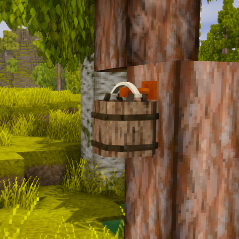

# Resin Grove

A C# tree tapping mod for **Vintage Story 1.22.7 / .NET 10**. Install on both the client and server.

**Release 1** · [GitHub](https://github.com/real-felix/vs-resin-grove) · [Report a bug](https://github.com/real-felix/vs-resin-grove/issues)



## Play

1. Smith one ingot into **two tree taps**. Copper, the three bronzes, silver, gold, iron, meteoric iron, and steel are supported.
2. Right-click a vertical face of a naturally grown **pine or acacia log** with a tap. Leave the neighboring space empty. The clicked log becomes a tapped log, keeping its wood and grain orientation.
3. Right-click that log with an **empty vanilla wooden bucket**. The bucket hangs in the neighboring block and fills with vanilla resin over game time.
4. Right-click the bucket to collect complete resin items. **Shift + right-click** returns the empty bucket and all complete resin items. Items that do not fit your inventory drop beside the bucket.

Breaking a tapped log returns its placed-log equivalent and the original tap. Removing the supporting tapped log drops the hanging bucket and its resin. Picking either block in creative mode returns the corresponding vanilla block, so it cannot be used to place artificial natural trees.

The first server launch creates `ModConfig/resingrove.json`:

```json
{
  "HoursPerResin": null,
  "BucketCapacity": 8
}
```

`HoursPerResin: null` follows each tree species' vanilla resin regrowth interval, read from the resolved `game:log-resinharvested-{wood}-ud` block's `transientProps.inGameHours`. The installed 1.22.7 assets specify 168 hours (seven standard in-game days). Changes to that property by other mods also apply. Set a positive number to override the interval; invalid numbers revert to following vanilla.

Existing numeric settings are preserved. Change `HoursPerResin` to `null` in `ModConfig/resingrove.json` to follow vanilla.

Restart the server after changing the config. Capacity is limited to 1–32 vanilla resin items. Filling stops at capacity; extra elapsed time is not banked. Fractional progress survives ordinary collection and world reloads. Removing a bucket discards progress toward the next whole item. Production uses the world's calendar, including time skipped by sleeping, and catches up when a still-valid tree's chunk reloads. It does not advance while the game server is stopped.

## Tree validation and persistence

- Only vanilla `game:log-grown-*` pine and acacia logs, plus this mod's tapped logs, connect the tree. Placed logs do not connect it.
- An iterative, bounded search follows connected wood, including diagonal acacia branches. Leaves are sampled immediately around the wood; leaf blocks are never traversed.
- A valid tree needs at least three connected logs, a height of at least three blocks, at least two matching foliage blocks above the base, and a log rooted on solid soil, sand, gravel, or stone. This is a practical living-tree heuristic, not a reconstruction of world generation history.
- The lowest grounded log is the canonical root, with X/Z used to break ties. Its chunk stores the tap's position. The tapped log's block entity stores the root and original tap item; the bucket's block entity stores the original bucket, resin, and production clock.
- A tap anywhere in the connected wood prevents another tap, even if the original base is changed. Directly touching trees of the same species conservatively count as one connected tree. Leaves touching between trees do not merge them.
- Searches stop at 512 logs, 32 blocks horizontally, or 64 vertically from the clicked log. Unloaded boundaries fail closed. Huge or connected forest structures can therefore be refused.
- Trees with hanging buckets are rechecked every 30 seconds and at collection time. Bare, disconnected, or unloaded trees produce no resin during that interval.
- Placement and interaction honor land claims. A bucket needs a free neighboring block with no fluid.

## Build

Install a **.NET 10 SDK** and Vintage Story 1.22.7. On macOS, the default game path is `/Applications/Vintage Story.app`. Elsewhere, set `VINTAGE_STORY` to the directory containing `VintagestoryAPI.dll` and `Mods/`.

```sh
export VINTAGE_STORY="/path/to/Vintage Story"
bash scripts/build.sh
```

`DOTNET` can select a particular SDK executable. The build uses the installed game's assemblies; it downloads no game libraries or NuGet packages. It runs the logic checks, then creates `artifacts/resingrove-1.0.0.zip`. Copy that ZIP into the game's data-directory `Mods/` folder. Do not install the integration-check mod.

## Publishing

GitHub Actions runs on pushes, pull requests, and manual dispatch. It downloads the official **server-only** 1.22.7 archive, verifies its pinned SHA-256, runs the logic checks, builds the mod, validates the ZIP, and uploads it as a downloadable artifact. No game account credentials or repository secrets are required. The game assemblies are build inputs and are excluded from the release ZIP.

Pushing a version tag also creates a **draft GitHub release** with the ZIP attached. Release 1 uses tag `v1`; game metadata and the project's `<Version>` use the game's required semantic format `1.0.0`. The validator accepts `v1` or `v1.0.0` for that version. You review the draft's notes and publish it from GitHub Releases. A rerun leaves an existing release unchanged.

For the first release:

1. The MIT license is included as `LICENSE`. Confirm the author name in `modinfo.json` and copyright holder in `LICENSE`.
2. The root-level `modicon.png` is a **480×480 PNG** made from the supplied `screenshot.png`. It works for both the in-game icon and the Mod DB's square logo. The Mod DB also accepts **480×320** logos. Keep a larger screenshot for its gallery.
3. Push the code to [the GitHub repository](https://github.com/real-felix/vs-resin-grove). Its URL is configured as `website` in `modinfo.json`; enable Issues if you want bug reports there.
4. Confirm the **Build mod** action succeeds. Record release notes in `CHANGELOG.md`.
5. Tag the release commit and push the tag:

   ```sh
   git tag -a v1 -m "Resin Grove 1"
   git push origin v1
   ```

6. Review and publish the generated draft release. Use the attached `resingrove-1.0.0.zip` for distribution; GitHub's automatically generated source archives are for source code.
7. Sign in to the [Vintage Story Mod DB](https://mods.vintagestory.at/), create a **Game Mod** entry for Resin Grove, and add its description, logo/gallery, source repository, issue tracker, and license. Set its side to **Universal** and explain that both client and server need it.
8. Add a release, upload the built ZIP, select **Vintage Story 1.22.7** as the tested game version, add the changelog, and set the mod's status to **Published**. Keep the mod ID `resingrove` stable for future updates.

Suggested short summary: “Smith tree taps and hang buckets to collect resin from living pine and acacia trees.” The Play and configuration sections above can form the mod page description.

Before later releases, update the version in both metadata files and add changelog notes. When changing the target game version, update the dependencies and the workflow's `VS_VERSION` and server-archive checksum together. The existing local server integration check is available through `python3 scripts/integration.py`; GitHub CI runs the game-independent checks and packaging validation.

Icon references: [official packaging documentation](https://wiki.vintagestory.at/Modding:Mod_Packaging) and [Mod DB logo size requirements](https://github.com/anegostudios/vsmoddb/blob/master/templates/edit-mod.tpl).

## Verification

```sh
dotnet run --project tests/ResinGrove.Tests -c Release
python3 scripts/integration.py
```

The first command checks tree identity, invalid trees, diagonal branches, duplicate taps, traversal bounds, production caps, save/restore, and calendar edge cases. The second builds and starts an isolated localhost server twice, verifies the actual registered recipes and blocks, production and drops, save/restart persistence, and removal cleanup, then deletes its disposable world. Logs go to `artifacts/integration-logs/`. It never uses your normal worlds or mod folder.

Client playtest checklist:

- Smith two taps from one ingot and confirm the recipe fits a single ingot's voxel budget.
- Tap pine and acacia from different heights and faces; confirm a second tap is refused without consuming the item.
- Reject placed logs, stumps, floating trunks, unsupported wood, and occupied tap faces.
- Hang an empty bucket; reject a bucket containing liquid.
- Accelerate the calendar to check the bucket's resin surface, collection, capacity, and all four orientations.
- Collect repeatedly with a full inventory; remove the bucket and break the supporting log; confirm no loss or duplication of complete items.
- Save/reload with a partially filled bucket and check that vanilla axe tree felling still crosses the tapped log.

## Source map

- `src/ResinGrove/Core/`: game-independent validation and production logic.
- `src/ResinGrove/`: game registration, item interaction, custom blocks, block entities, rendering, and root-chunk reservations.
- `assets/resingrove/`: item/block definitions, smithing recipe, tap geometry, resin surface, and English text. Vanilla textures and bucket geometry are referenced from the installed game.
- `tests/ResinGrove.Integration/`: disposable server-only test mod; excluded from the release package.

API references: [official survival-mod source](https://github.com/anegostudios/vssurvivalmod), [smithing recipe documentation](https://wiki.vintagestory.at/Modding:Asset_Type_-_Recipes_(Smithing)).

## License

[MIT](LICENSE).
